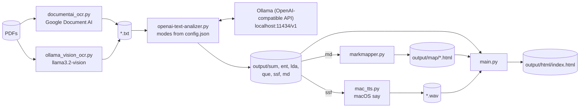

# openai-text-analizer

A set of Python scripts that turn documents into study material: OCR PDFs, run configurable LLM prompts over the text (summaries, entities, topics, questions, mind maps), optionally read the results aloud, and bundle everything into a static HTML site.

## Overview

The project started as a single script that sent text files to the OpenAI API and has grown into a small local
pipeline. The core script, `openai-text-analizer.py`, uses the OpenAI Python client against any OpenAI-compatible
endpoint; it is currently wired to a **local [Ollama](https://ollama.com/) server** (`llama3.2` by default). Each "mode"
is a prompt defined in `config.json`, so new analyses can be added without touching code.

Around it are helper scripts to get text in (Google Document AI or an Ollama vision model for OCR) and to get results out
(markmap mind maps, macOS text-to-speech, and a tabbed HTML viewer per document). It is aimed at anyone who wants to
digest long readings, such as book chapters, papers or notes, with local models.

## Features

- **Prompt modes** from `config.json`, each writing to `output/<mode>/<file>.<ext>`:

  | Mode | Output |
  | --- | --- |
  | `sum` | Summary in the author's style (Markdown) |
  | `ent` | Markdown table of entities with type, context and analysis |
  | `lda` | Main topics as a markmap mind map |
  | `que` | Comprehension, analysis and application questions with answers |
  | `ssf` | Text reformatted for text-to-speech |
  | `md`  | Whole text as a markmap mind map |

- Runs all modes by default, or one with `--m`; skips outputs that already exist, so runs can be resumed.
- Splits long inputs into chunks (by characters, using `max_tokens` from the config) and concatenates the responses.
- **OCR options**:
  - `documentai_ocr.py`: splits PDFs into single pages, sends them to a Google Document AI processor, caches each JSON
    response, strips header/footer patterns and writes per-page and combined text (Google Cloud Text-to-Speech code is
    present but commented out).
  - `ollama_vision_ocr.py`: renders PDF pages to PNG with PyMuPDF and asks `llama3.2-vision` to transcribe them.
- **Outputs**:
  - `markmapper.py`: wraps `output/md/*.md` in interactive markmap HTML pages (`output/map/`).
  - `mac_tts.py`: speaks `output/ssf/*.ssf` with the macOS `say` command and combines the WAVs with pydub.
  - `main.py`: builds `output/html/` with one page per document (tabs for mind map, topics, entities, TTS text, summary
    and questions, embedded audio when available, resizable split view) plus an `index.html`.

## Architecture



## Requirements

- Python 3.8+
- Ollama running locally with the model named in `config.json` (default `llama3.2:latest`); `llama3.2-vision` for
  `ollama_vision_ocr.py`.
- Python packages: `requirements.txt` pins only `openai`, `markdown` and `natsort` (plus `argparse` and `pathlib`, which
  are in the standard library). The helper scripts also need packages that are **not** listed:
  - `documentai_ocr.py`: `requests`, `PyPDF2`, `google-auth`, `google-cloud-texttospeech`, `pydub`, `reportlab`
  - `ollama_vision_ocr.py`: `ollama`, `PyMuPDF`, `PyPDF2`
  - `mac_tts.py`: `pydub` (and ffmpeg), macOS for `say`
- For Document AI: a Google Cloud project with a Document AI OCR processor and a service account key.

## Installation and quick start

```bash
git clone https://github.com/Lapeyus/openai-text-analizer.git
cd openai-text-analizer
python -m venv .venv && source .venv/bin/activate
pip install -r requirements.txt

ollama pull llama3.2

mkdir -p txt && cp /path/to/*.txt txt/
python openai-text-analizer.py            # all modes, ./txt -> ./output
python markmapper.py                       # output/md -> output/map
python main.py                             # build output/html/index.html
open output/html/index.html
```

## Usage

```bash
# One mode, custom folders
python openai-text-analizer.py --f ./chapters --m sum --output ./output

# Speak the TTS-formatted text (macOS)
python mac_tts.py

# OCR with Document AI (reads PDFs from the current directory)
python documentai_ocr.py --header "Chapter \d+" --footer "Page \d+"

# OCR with a local vision model (reads ./pdfs, writes ./extracted_texts)
python ollama_vision_ocr.py
```

`openai-text-analizer.py` flags:

| Flag | Default | Meaning |
| --- | --- | --- |
| `--f` | `./txt` | Folder with input `.txt` files (created if missing) |
| `--m` | `all` | A mode key from `config.json`, or `all` |
| `--output` | `./output` | Base output folder |

`markmapper.py` and `main.py` take optional positional folder arguments; their defaults match the layout above.

## Repository structure

```text
openai-text-analizer/
├── openai-text-analizer.py   # Core: runs prompt modes over ./txt via an OpenAI-compatible client
├── config.json               # Model parameters and the prompt for each mode
├── documentai_ocr.py         # PDF -> pages -> Document AI -> cleaned text (+ disabled Cloud TTS)
├── ollama_vision_ocr.py      # PDF -> PNG pages -> llama3.2-vision -> text
├── markmapper.py             # Markdown -> markmap HTML
├── mac_tts.py                # .ssf text -> WAV with macOS say, combined with pydub
├── main.py                   # Builds the tabbed HTML viewer and index
├── requirements.txt
├── .pre-commit-config.yaml
├── .github/                  # Dependabot config and issue templates
├── CONTRIBUTING.md, SECURITY.md  # GitHub template placeholders
└── LICENSE                   # Apache License 2.0
```

## Configuration

- `config.json` → `default`: `model`, `temperature`, `max_tokens`, `top_p`, `frequency_penalty`,
  `presence_penalty`, `encoding`, `api_key`. → `modes`: one entry per mode with `prompt` and `file_extension`.
  Add a mode by adding an entry.
- `OPENAI_API_KEY` (environment) or `api_key` in `config.json` is used only on the OpenAI code path. Do not commit a
  real key in `config.json`.
- `documentai_ocr.py` reads a service account key from `./key.json` and has the Document AI processor endpoint and
  folder paths as constants at the top of the file; change them to your own processor. Keep `key.json` out of git.
- Folder paths in `ollama_vision_ocr.py` and `mac_tts.py` are constants in the scripts.
- Generated folders (`txt/`, `output/`, `pdf/`, `responses/`, `texts/`, `audio/`, `temp_images/`,
  `extracted_texts/`) are local working data and should not be committed.

## Tests

There are no automated tests.

## Project status

Personal tool, low activity. Created September 2023; last commit November 2024 (Ollama, Document AI and vision OCR
additions).

## Known limitations

- `main()` always calls `initialize_client("ollama", ...)`; using the OpenAI API requires editing that line.
- Chunking is by characters while the setting is called `max_tokens`; the same value is also sent as the response
  `max_tokens`. The default (131072) suits large-context local models, not every model.
- The `--m` help text lists `ssm` and `map`, but the configured modes are `ent`, `sum`, `ssf`, `lda`, `que`, `md`.
- `ollama_vision_ocr.py` returns the whole `message` object instead of its text content, so writing the output file
  may fail or need adjustment.
- `mac_tts.py` and `ollama_vision_ocr.py` have no command-line options; their folders are hard-coded (`mac_tts.py` runs
  its loop at module level, without a `__main__` guard).
- `CONTRIBUTING.md` and `SECURITY.md` are unedited GitHub templates.

## License

Apache License 2.0. See [LICENSE](LICENSE).
